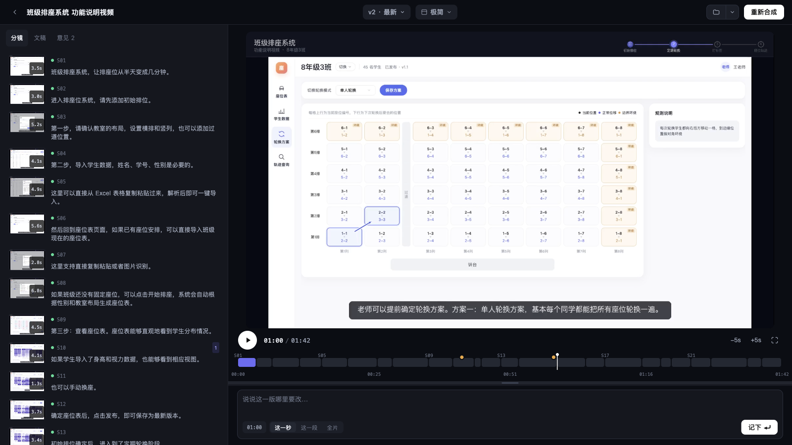

# 审片台 ClipDesk

> 本地视频审片与返工工具。在浏览器里边看片边写意见，AI 按意见改片，只重渲改动过的镜头。

做视频最烦的不是做第一版，是改第十版。每次改一句话，都要重录、重配音、重新合成整片，一小时就没了。

审片台把这件事拆开了：**看片写意见 → 局部重渲 → 出新版本**。改一个镜头只渲那一个，其余复用缓存。



---

## 一句话安装

**把下面这段话直接发给你的 AI Agent**（Claude Code / Codex / Cursor / DSH 等任何能执行终端命令的助手）：

```
帮我安装并配置审片台 ClipDesk：
https://github.com/yueqi7255-box/clipdesk

请依次完成，每步都要确认结果：

1. 克隆仓库到 ~/clipdesk
   git clone https://github.com/yueqi7255-box/clipdesk.git ~/clipdesk

2. 运行安装脚本
   cd ~/clipdesk && bash install.sh

3. 确认安装成功：
   - clipdesk status 能正常输出（检查 ffmpeg / say / Pillow / 视频根目录）
   - Skill 已安装到 ~/.dsh/skills/clipdesk/SKILL.md
   - INSTALL_PATH 文件存在且指向 ~/clipdesk
   任何一项缺失都要补装，并把问题告诉我

4. 读一遍 ~/.dsh/skills/clipdesk/SKILL.md，告诉我你知道怎么用这个工具了

装好后，用一句话总结：你装到了哪、能做什么。
```

AI 会自己完成克隆、安装、环境检查，并把结果告诉你。**你不需要打开终端。**

安装完成后，`clipdesk` 命令和一个配套的 AI Skill 都已就位，接下来直接用自然语言指挥它。

---

## 配套 Skill

clipdesk 只管**渲染与返工**，不负责录屏。

要做「从零录一个演示视频」，需要配套的录制 Skill：

| Skill | 作用 | 安装方式 |
| --- | --- | --- |
| **demo-video** | 分析系统 → 设计分镜 → 录屏 → 切片 → 接入 clipdesk | `install.sh` 自动安装 |
| **clipdesk** | 渲染、审片、返工、出成片 | `install.sh` 自动安装 |

两个 Skill 会一起装到 `~/.dsh/skills/`。

### 两者怎么配合

```
demo-video 录制 + 切片  →  产出 clipdesk 项目结构
                              ↓
                        clipdesk 渲染预览
                              ↓
                          你审片写意见
                              ↓
        ┌─────────────────────┴─────────────────────┐
        ↓                                           ↓
   文案/时长类修改                            画面要重录
   clipdesk 直接改                          回到 demo-video
```

**接口是数据格式，不是 Skill 名字。** 只要产出符合 `footage/record.json` + `project.json` 规范，任何录制方式都能接入。

### 只做纯文字视频？

不需要 demo-video。直接在 `project.json` 里写镜头和文稿，`footage` 留 `null`，clipdesk 会渲染纯色文字卡。

---

## 与 AI 协作

这是这个工具的核心用法：**你不用记命令，直接用说话的方式让 AI 干活。**

### 首次建项目

```
帮我用审片台建一个视频项目，名字叫「产品介绍」，
素材文件夹在 ~/Desktop/录屏素材
```

AI 会创建项目目录、读取素材帧、生成 `project.json` 骨架。

### 写文稿并渲染

```
这个项目有 24 个镜头，先把第一版渲染出来看看
```

或者直接给文稿：

```
镜头 S01 说「这是我们的新产品」，时长 3 秒
镜头 S02 说「它能让效率翻倍」，时长 4 秒
按这个渲染一版
```

### 审片后让它改（预览）

在浏览器里看完片，把要改的地方**在对应时间点写成意见**，然后对 AI 说：

```
处理意见
```

AI 会：

1. 读取你在网页上写的所有意见
2. 逐条判断该改文稿、调时长、还是需要重录画面
3. 直接执行修改（**不会先让你确认一遍**）
4. **只重渲受影响的镜头**（预览模式，不生成成片）
5. 页面自动刷新，你接着看

### 满意了，出成片

反复几轮后觉得可以了，说：

```
出成片
```

AI 会拼接所有镜头、合成音轨，输出：

```
versions/v6/项目名-v6.mp4
```

**这个文件就是最终交付物**，可以直接发给别人。

### 其它常用对话

| 你说 | AI 做什么 |
| --- | --- |
| 「有哪些项目」 | 列出所有工作区及待处理意见数 |
| 「切到极简模板重新渲染」 | 改模板配置并重渲预览 |
| 「出成片」 | 拼接完整视频，输出到 versions/ |
| 「这个镜头太长，缩到 3 秒」 | 调整时长并重渲该镜头 |
| 「把第 2 句文案改一下」 | 修改文稿、重新配音、重渲 |
| 「在 Finder 里打开项目」 | 打开项目所在文件夹 |

### 为什么 AI 能听懂

`install.sh` 会往 `~/.dsh/skills/clipdesk/` 装一个 Skill，里面写清了这个工具的完整用法、数据结构、渲染流程和判断规则。

AI 读到这份 Skill 就知道：意见存在哪、怎么改、怎么只重渲一个镜头、怎么给新版本编号。

**如果你用的 Agent 不自动读 Skill**，把这句话加在对话开头即可：

```
参考本地 Skill：~/.dsh/skills/clipdesk/SKILL.md
```

---

## 手动安装（可选）

如果你想自己控制，也可以在终端里执行：

```bash
git clone https://github.com/yueqi7255-box/clipdesk.git ~/clipdesk
cd ~/clipdesk
bash install.sh
```

安装脚本做这些事：

1. 检查 Node.js 版本（需 ≥ 18）
2. 准备 `ffmpeg`（内置优先，其次系统，最后自动下载）
3. 检查 macOS `say` 与中文音色
4. 把 `clipdesk` 注册到 `~/.local/bin`
5. 安装 AI Skill 到 `~/.dsh/skills/clipdesk`
6. 跑环境自检

### 环境要求

- **macOS**（配音用 `say`，开窗口用 `open`，其他平台部分功能不可用）
- **Node.js ≥ 18**
- **Python 3 + Pillow**：`pip3 install Pillow`

ffmpeg 不用手动装，脚本会处理。

### 检查是否装好

```bash
clipdesk status
```

正常输出：

```
环境检查：
  Node    v22.19.0
  ffmpeg  /Users/you/clipdesk/bin/ffmpeg
  say     可用
  Pillow  12.3.0
  平台    darwin
  视频根  /Users/you/Videos/clipdesk
  服务    未启动 http://127.0.0.1:4300
```

---

## 工作流

整体是这样的：

```
① 建项目 ──→ ② 放素材 ──→ ③ 写镜头 ──→ ④ 渲染
                                            │
                                            ↓
                        ⑥ AI 按意见改片 ←── ⑤ 浏览器审片写意见
                                │
                                └──→ 新版本 → 回到 ⑤
```

**通常你只需要参与 ⑤**：看片、写意见，其余交给 AI。

---

## 项目结构

一个视频项目就是一个普通文件夹：

```
你的项目/
├── project.json      ← 镜头、文稿、意见、版本（核心数据）
├── footage/
│   ├── record.json   ← 录屏的帧时间戳与点击坐标
│   └── frames/       ← 帧序列 f00000.png, f00001.png …
├── voice/            ← 配音（自动生成）
├── segments/         ← 分段缓存（视频+音轨，自动生成）
├── preview/          ← 预览片（自动生成，随改随更新）
├── thumbs/           ← 镜头缩略图（自动生成）
└── versions/         ← 成片（每次导出产生一版）
    └── v1/项目名-v1.mp4
```

### project.json 长什么样

```json
{
  "name": "产品介绍",
  "currentVersion": 2,
  "shots": [
    {
      "id": "S01",
      "voice": {
        "text": "这是我们的新产品。",
        "duration": 3.0
      },
      "duration": 3.0,
      "footage": { "start": 0.5, "end": 4.0 }
    }
  ],
  "notes": [
    {
      "time": 12.4,
      "shotId": "S03",
      "text": "这句太快了，慢一点",
      "status": "open"
    }
  ],
  "config": {
    "template": "classic"
  }
}
```

| 字段 | 含义 |
| --- | --- |
| `voice.text` | 该镜头的解说词 |
| `voice.duration` | 配音时长（TTS 自动写回） |
| `duration` | 该镜头在成片中的时长 |
| `footage.start` / `end` | 素材在录制时间轴上的起止秒数 |
| `notes` | 审片意见，`time` 是成片时间点 |
| `config.template` | 外壳模板名 |

### 素材格式

如果有录屏素材，放进 `footage/frames/`，并写 `footage/record.json`：

```json
{
  "frames": [
    { "idx": 0, "t": 0 },
    { "idx": 1, "t": 87 }
  ],
  "clicks": [
    { "t": 4141, "x": 866, "y": 273 }
  ],
  "duration": 142600
}
```

- `frames[].t`：该帧相对录制开始的毫秒数
- `clicks[].t`：点击事件相对录制开始的毫秒数
- 帧文件名：`f` + 5 位序号 + `.png`，如 `f00007.png`

**没有素材也能跑**：只写文稿不接录屏，会生成纯色文字卡版本，适合先验证流程。

---

## 审片台界面

打开 `http://127.0.0.1:4300` 后：

- **左侧**：分镜列表（带缩略图）／文稿／意见，三个页签
- **右侧**：播放器 + 时间轴 + 意见输入框
- **点时间轴上的分镜块**：跳到该镜头并播放
- **拖动时间轴**：任意定位
- **写意见**：暂停在要改的地方，输入内容，选择范围（这一秒／这一段／全片）

意见会自动记录时间点和所属镜头，直接写入 `project.json`，AI 立刻能读到。

页头还有**版本下拉**（切历史版本）和**模板下拉**（换视觉风格）。

---

## 外壳模板

视频的顶栏、字幕、节点图由模板控制，切换只改一个字符串：

```json
"config": { "template": "classic" }
```

内置三套：

| 模板 | 效果 |
| --- | --- |
| `classic` | 深色顶栏 + 四阶段节点图，148px 顶栏，字幕 29px |
| `minimal` | 无顶栏，画面占满，字幕 34px |
| `bold` | 高对比，176px 顶栏，大号节点，字幕 33px |

模板文件在 `templates/*.json`，参数包括画布尺寸、颜色、字号、边距、圆角。

**改 JSON 就能调样式，不用动代码。** 想让 AI 帮你做新模板：

```
参考 templates/classic.json 的结构，做一个「商务风」模板：
浅灰顶栏、深蓝强调色、字幕小一点
```

---

## 命令行参考

日常用 AI 就够了，这里是备用。

| 命令 | 说明 |
| --- | --- |
| `clipdesk` | 启动服务并打开浏览器 |
| `clipdesk web` | 只启动服务 |
| `clipdesk render <项目>` | 渲染**预览**（只重渲改动镜头，不出成片） |
| `clipdesk export <项目>` | 导出**成片**到 `versions/vN/项目名-vN.mp4` |
| `clipdesk thumbs <项目>` | 生成缩略图 |
| `clipdesk list` | 列出所有项目 |
| `clipdesk new <名称> [路径]` | 新建项目 |
| `clipdesk status` | 环境检查 |

项目参数支持 id、全名或名称片段。

### 预览 vs 出成片

这是两个不同操作：

| | 什么时候用 | 做什么 | 产物 |
| --- | --- | --- | --- |
| **预览** | 日常改片，频繁 | 重渲受影响镜头，拼成预览片 | `preview/preview.mp4`（覆盖更新） |
| **出成片** | 审片满意，一次 | 同样的拼接，输出正式文件名 | `versions/vN/项目名-vN.mp4` |

**关键设计：每个分段自带音轨。**

渲染一个镜头时，就把该镜头的配音合进 `segments/S01.mp4`（视频 + 音频）。
所以预览和导出都只是「拼接」，不需要单独重建音轨：

- 预览有声音，且反映最新改动
- 导出快（实测 6.7 秒，对比旧方案 267 秒）

预览很快，因为只渲改动的那一个：

```
✓ 预览已更新
  时长 104.9s · 耗时 22.9s
  分段：新渲 1 / 复用 23（共 24）
```

播放器播的是 `preview/preview.mp4`，自带音轨，随改随看。

出成片会完整拼接一次：

```
✓ 成片已导出
  版本 v7 · 时长 104.3s · 耗时 6.7s
  文件 versions/v7/产品介绍-v7.mp4
  可直接发送：产品介绍-v7.mp4
```

---

## 配置

| 环境变量 | 默认值 | 说明 |
| --- | --- | --- |
| `CLIPDESK_VIDEO_ROOT` | `~/Videos/clipdesk` | 项目根目录 |
| `CLIPDESK_PORT` | `4300` | 服务端口 |
| `CLIPDESK_FONT` | 自动探测 | 中文字体路径 |
| `FFMPEG_PATH` | 自动探测 | ffmpeg 路径 |

---

## 技术实现

```
录屏帧序列 ──┐
文稿 ────────┼─→ Python 逐帧合成 ─→ PNG 序列 ─→ ffmpeg 编码 ─→ 分段 mp4
模板 ────────┘                                    │
                                                  ↓
                                          按顺序拼接 ─→ 整片
                                                  ↑
配音 ──→ 每段补齐到镜头时长 ──→ 完整音轨 ──────────┘
```

**为什么用 Python 合成而不是 ffmpeg filter**：顶栏节点图、指针涟漪这类效果用 filter 表达很笨重，逐帧绘制更自由。

**为什么音轨要补齐**：配音时长和镜头时长可能不一致，直接拼接会音画错位。每段音频先补齐裁到精确时长，再接起来。

**缓存策略**：镜头内容 + 文稿 + 时长 + 模板 + 画布尺寸 → SHA 指纹。指纹没变直接复用，所以改一句话只重渲一个镜头。

---

## 目录结构

```
clipdesk/
├── bin/clipdesk          CLI 入口
├── server.js             本地 HTTP 服务
├── lib/
│   ├── workspace.js      项目注册与读写
│   ├── pipeline.js       渲染流水线
│   ├── render.js         分段渲染与拼接
│   ├── composite.py      逐帧合成（外壳绘制）
│   ├── footage.js        素材帧索引
│   └── voice.js          TTS 配音
├── public/index.html     审片台前端
├── templates/            外壳模板
├── skill/clipdesk/       AI Skill（安装时复制到 ~/.dsh/skills/）
└── install.sh            一键安装
```

---

## 已知限制

- 只支持 macOS（依赖 `say` / `open` / `osascript`）
- 不能自己录制操作画面，需要外部录屏工具产出帧序列
- 配音依赖 macOS 中文音色，其他语言需调整
- 单机工具，没有多用户协作
- AI 协作依赖 Agent 能读 Skill 和执行终端命令

---

## License

MIT
